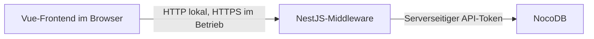

# Middleware: Einrichtung, Build und Betrieb

Diese Anleitung beschreibt die serverseitige NocoDB-Middleware und ihre
Anbindung an Wurzelpartner. Frontend und Middleware sind getrennte Anwendungen
mit eigenen Installations-, Build- und Startschritten.

## Architektur und Geheimnisse



Der Browser kennt nur die URL der Middleware. Die Middleware verwendet ihren
eigenen NocoDB-Token, um die freigegebenen Daten serverseitig abzurufen.

| Einstellung                                | Ablage                            | Geheim?               |
| ------------------------------------------ | --------------------------------- | --------------------- |
| `VITE_MIDDLEWARE_API_URL`                  | Frontend-Konfiguration            | Nein                  |
| `NOCODB_API_URL`, `NOCODB_BASE_ID`         | Backend-Konfiguration             | Keine Zugangsdaten    |
| Ressourcen, Feldmapping und Tabellenrechte | Geschuetzte NocoDB-Systemtabellen | Administrativ pflegen |
| `NOCODB_API_TOKEN`                         | Nur Backend-Laufzeitkonfiguration | Ja                    |
| `JWT_SECRET`                               | Nur Backend-Laufzeitkonfiguration | Ja                    |

**Wichtig:** `VITE_*`-Werte werden in den Browsercode eingebaut. Auch eine
ignorierte `.env.local` macht einen dort verwendeten API-Key nicht geheim.

Beim manuellen Start liegt die serverseitige `.env` im Middleware-Projekt.
Das unten beschriebene Wurzelpartner-Skript verwendet eine getrennte, ignorierte
`.env.middleware` oder eine explizit angegebene Datei. Diese Dateien duerfen
nicht oeffentlich ausgeliefert werden, in Git oder ein Container-Image gelangen.
Im Serverbetrieb sind die Secret-Verwaltung des
Hosters oder eine nur fuer den Dienst lesbare Konfigurationsdatei vorzuziehen.
Geheimnisse nicht in Logs oder Screenshots ausgeben.

## Voraussetzungen

- Ein erreichbarer NocoDB-Server mit der passenden Base und den Anwendungstabellen.
- Der aktuelle Middleware-Quellstand mit dem Public-Read-Modul; das fruehere
  Release `v0.6.0` bietet die benoetigten Routen noch nicht.
- Middleware: Node.js >=24.9.0 und npm. Lokal wurde Node.js 24.22.1 verwendet.
- Frontend: die Node-Version aus der [Projektvorgabe](../.nvmrc).
- Fuer die gezeigten `nvm`-Befehle muss nvm bereits eingerichtet sein.

Die absoluten Projektpfade in den folgenden Beispielen entsprechen diesem
Workspace. Auf einem anderen Rechner muessen sie angepasst werden.

## Middleware konfigurieren

Im separaten Projekt `nocodb-middleware` liest die Anwendung ihre `.env` aus dem
Arbeitsverzeichnis. Alternativ werden die Werte als Laufzeit-Umgebungsvariablen
des Serverprozesses gesetzt. Die dortige `.env.example` dokumentiert weitere
Einstellungen.

Beispiel fuer die lokale Backend-Konfiguration; Platzhalter ersetzen:

```dotenv
NODE_ENV=development
PORT=3000

NOCODB_API_URL=http://localhost:8080
NOCODB_API_TOKEN=DEIN_GEHEIMER_NOCODB_TOKEN
NOCODB_BASE_ID=DEINE_BASE_ID
JWT_SECRET=DEIN_STARKES_ZUFAELLIGES_GEHEIMNIS
AUTH_PROVIDER=local

CORS_ORIGINS=http://localhost:5173
```

Ressourcen und Rechte werden in NocoDB konfiguriert, nicht durch eigene
Backend-Variablen je Anwendung. Den NocoDB-Token auf die fuer den Dienst notwendigen Rechte
begrenzen. Fuer `JWT_SECRET` ein eigenes kryptografisch zufaelliges Geheimnis
mit mindestens 256 Bit verwenden, nicht den NocoDB-Token wiederverwenden.

`AUTH_PROVIDER=local` ist der vorhandene JWT-Pruefmodus der Middleware und
stellt keinen neuen Login-Endpunkt bereit. Die oeffentlichen Leserouten
benoetigen weder JWT noch NocoDB-Key vom Browser.

Es werden keine Ressourcen oder anonymen Leserechte automatisch freigegeben.
Erst aktivieren, wenn die ausgewaehlten Daten einschliesslich Bilder und Logos
oeffentlich sein duerfen. CORS bestimmt, welche Browser-Origin Antworten lesen
darf, ersetzt aber keine Authentifizierung: Die freigegebenen GET-Routen sind
auch ausserhalb des Browsers oeffentlich abrufbar.

## Ressourcen in NocoDB einrichten

Die Middleware legt beim Start die leeren Tabellen `api_resources`,
`api_resource_fields` und `api_resource_filters` sowie die unberechtigte Rolle
`anonymous` an. Ein gesetztes `NOCODB_TABLE_PREFIX` gilt auch fuer diese
Tabellen. Der Token muss die erforderlichen Meta-/Datenzugriffe erlauben;
alternativ das dokumentierte Schema administrativ vorab anlegen. Diese Tabellen
sind weder im normalen Tabellenkatalog noch ueber `/api/data/:table` erreichbar.
Die Einrichtung erfolgt mit administrativen Rechten direkt in NocoDB.

### 1. Tatsaechliche Tabellennamen feststellen

Die Ressourcen verwenden **logische Tabellennamen**, keine Tabellen-IDs. Bei
gesetztem Praefix wird dieses nur im NocoDB-Tabellentitel gefuehrt, nicht in der
Konfiguration oder den Tabellenrechten. Die bisherigen IDs dienen nur dazu,
die richtigen Tabellen in der bestehenden Base zu finden:

| Ressource          | Bisherige Tabellen-ID zur Zuordnung |
| ------------------ | ----------------------------------- |
| `tree-info`        | `msiujkp7wh01rvt`                   |
| `locations`        | `mgnjjdbdzie74ur`                   |
| `partner-sponsors` | `m0syxl6tq6ufvgi`                   |

Die tatsaechlichen Titel in NocoDB pruefen, nicht die Ressourcennamen als
Tabellennamen voraussetzen. Tabellennamen erlauben Buchstaben, Ziffern,
Leerzeichen, `_` und `-`, ohne aeussere Leerzeichen.

### 2. Ressourcen deaktiviert anlegen

In `api_resources` drei Zeilen anlegen:

| `resource_name`    | `table_name`                                 | `enabled` |
| ------------------ | -------------------------------------------- | --------- |
| `tree-info`        | Logischer Titel der Baumarten-Tabelle        | false     |
| `locations`        | Logischer Titel der Standort-Tabelle         | false     |
| `partner-sponsors` | Logischer Titel der Partner-/Sponsor-Tabelle | false     |

Die erzeugten numerischen IDs notieren. Im Folgenden stehen `R_TREE`,
`R_LOCATION` und `R_PARTNER` fuer diese **numerischen Werte**, nicht fuer
woertlich einzutragenden Text. Ressourcennamen sind eindeutig und entsprechen
`[a-z][a-z0-9-]{0,62}`.

### 3. Antwortfelder freigeben

In `api_resource_fields` je eine Zeile pro Mapping anlegen. Die Spalten sind
`resource_id` (Number), `source_field`, `response_field`, `normalization` und
`default_json` (LongText mit JSON oder leer):

| `resource_id` | `source_field` | `response_field` | `normalization` | `default_json` |
| ------------- | -------------- | ---------------- | --------------- | -------------- |
| R_TREE        | Name           | name             | none            |                |
| R_TREE        | Abstract       | abstract         | none            |                |
| R_TREE        | Description    | description      | none            |                |
| R_TREE        | Picture        | picture          | lowerFirstDeep  | `[]`           |
| R_LOCATION    | Name           | name             | none            |                |
| R_LOCATION    | GeoLocation    | geoLocation      | none            |                |
| R_PARTNER     | Name           | name             | none            |                |
| R_PARTNER     | Type           | type             | none            |                |
| R_PARTNER     | Logo           | logo             | lowerFirstDeep  |                |
| R_PARTNER     | Website        | website          | none            |                |
| R_PARTNER     | Description    | description      | none            |                |

Quellfelder muessen mit den tatsaechlichen Feldtiteln uebereinstimmen.
`id` wird automatisch ausgegeben und darf nicht ueberschrieben werden.
Antwortnamen sind eindeutige einfache Schluessel; keine Punktpfade oder
Prototype-Schluessel. `lowerFirstDeep` normalisiert verschachtelte Schluessel
wie `SignedUrl` nach `signedUrl`; Attachments einschliesslich ihrer URLs und
Metadaten werden damit bewusst freigegeben. `default_json` gilt nur bei
fehlendem oder nullwertigem Quellwert.

### 4. Partner-/Sponsor-Filter konfigurieren

In `api_resource_filters` eine Zeile anlegen:

| Feld                  | Wert                           |
| --------------------- | ------------------------------ |
| `resource_id`         | Numerischer Wert von R_PARTNER |
| `query_param`         | `type`                         |
| `source_field`        | `Type`                         |
| `required`            | true                           |
| `allowed_values_json` | `["Partner","Sponsor"]`        |

Es gibt nur Gleichheitsfilter; mehrere konfigurierte Filter werden mit AND
verknuepft. Der Browser kann keine Tabellen, Feldlisten, Sortierung oder freien
NocoDB-Ausdruecke bestimmen. Erforderliche Filter gelten nur fuer Listen,
Detailabrufe akzeptieren keine Query-Parameter.

### 5. Leserechte vergeben und zuletzt aktivieren

Die numerische ID der Rolle mit `role_name=anonymous` aus `roles` ermitteln.
In `table_permissions` je genau eine Zeile fuer diese Rolle und die drei
**tatsaechlichen logischen Tabellennamen** anlegen: `role_id` als Number,
`can_read=true`, alle Schreibrechte false. Ohne Rolle oder ausdrueckliches
Leserecht bleibt die Ressource gesperrt. Doppelte Rollen oder Rechtezeilen
werden als Konfigurationsfehler abgewiesen. Es ist kein kuenstlicher Benutzer
und keine Zuordnung in `user_roles` notwendig.

Erst nach Pruefung aller Daten in `api_resources` jeweils `enabled=true`
setzen. Aenderungen an Ressourcen, Feldern und Filtern wirken ohne Neustart
spaetestens nach 30 Sekunden beim naechsten Zugriff. Leserechte werden vor
jeder Antwort frisch geprueft, auch wenn Nutzdaten bereits gecacht sind. Ein
Entzug sperrt nachfolgende Anfragen; bereits laufende werden nicht abgebrochen.

Bei ungueltiger Konfiguration oder nicht erreichbarer Rechtequelle werden keine
gecachten Antworten freigegeben. Fehlerhafte/verwaiste Konfigurationszeilen
koennen den gesamten Snapshot sperren. Fuer groessere Umbauten deaktivieren,
konsistent bearbeiten und zuletzt aktivieren; Aenderungen ueber mehrere
NocoDB-Tabellen sind nicht atomar. Die Middleware-Rechte sind nicht automatisch
die nativen NocoDB-Benutzerrechte.

Die alten `WURZELPARTNER_*`-Variablen werden nicht mehr ausgewertet. Es gibt
keinen stillen Rueckfall auf die bisherigen Freigaben. Diese Umstellung muss
vor dem Einsatz des neuen Backend-Stands administrativ vorbereitet werden.
Weitere Ressourcen werden kuenftig nur durch neue Konfigurations- und
Rechtezeilen angelegt, ohne Middleware-Codeaenderung oder neues Deployment.

## Middleware lokal starten

In einem eigenen Terminal:

```sh
cd /home/ssr/private/projects/nocodb-middleware
nvm use 24.22.1
npm ci
npm run start:dev
```

Ist die genannte Node-Version noch nicht installiert, zuerst
`nvm install 24.22.1` ausfuehren. `npm ci` wird bei der Ersteinrichtung und nach
Aenderungen an der Lockdatei benoetigt. `start:dev` kompiliert TypeScript und
startet den Server nach Codeaenderungen automatisch neu.

Standardadressen:

- API: <http://localhost:3000/api>
- Healthcheck: <http://localhost:3000/api/health>
- Swagger im Entwicklungsmodus: <http://localhost:3000/api/docs>

Bei einem anderen `PORT` die URLs entsprechend anpassen. Nach Aenderungen an
der Backend-Konfiguration den Prozess neu starten.

### Start ueber das Wurzelpartner-Skript

Im Wurzelpartner-Projekt einmalig die serverseitige Vorlage vorbereiten:

```sh
cp .env.middleware.example .env.middleware
chmod 600 .env.middleware
```

In `.env.middleware` mindestens `NOCODB_API_URL`, `NOCODB_API_TOKEN`,
`NOCODB_BASE_ID`, `JWT_SECRET` und `CORS_ORIGINS` eintragen. Das JWT-Secret muss
mindestens 32 zufaellige Zeichen enthalten. Die Release-Variable bleibt beim
lokalen Start leer. Die Backend-Abhaengigkeiten vorher einmal mit `npm ci`
im Middleware-Checkout installieren. Dann aus dem Wurzelpartner-Projekt:

```sh
nvm use
npm run backend:dev -- --backend-dir /pfad/zum/nocodb-middleware
```

Ohne `--backend-dir` wird `../nocodb-middleware` relativ zu Wurzelpartner
verwendet; alternativ kann `MIDDLEWARE_DIR` gesetzt werden. Im aktuellen
Mehrfach-Workspace liegen die Repositories nicht direkt nebeneinander, daher
den tatsaechlichen Pfad angeben. Eine andere Env-Datei laesst sich explizit waehlen:

```sh
bash scripts/start-backend.sh --backend-dir /pfad/zum/nocodb-middleware --env-file /sicherer/pfad/backend.env
bash scripts/start-backend.sh --help
```

Relative Optionspfade beziehen sich auf das aktuelle Arbeitsverzeichnis.
Das Skript prueft Node >=24.9, Checkout, installierte Abhaengigkeiten und
Pflichtwerte und startet anschliessend `npm run start:dev` im Backend. Es
installiert nichts und erzwingt `NODE_ENV=development`. Der Node-Dotenv-Parser
laedt die Datei ohne Shell-Auswertung; Tokens mit `$`, `#` oder Leerzeichen
in einfache Anfuehrungszeichen setzen. Bereits exportierte Variablen haben
Vorrang. Vorhandene Backend-`.env`-Dateien koennen weitere, hier nicht gesetzte
Einstellungen ergaenzen; konkurrierende Konfigurationen vermeiden.

Die echte `.env.middleware` ist von Git ausgeschlossen und kein Vite-Env-Modus.
Sie darf dennoch niemals ausgeliefert werden: Der Webserver darf nur `dist/`
bereitstellen, nicht den Projektordner. Auf Produktionshosts kann die Datei
auch ausserhalb des Repositories liegen. `VITE_MIDDLEWARE_API_URL` bleibt eine
separate, oeffentliche Frontend-Einstellung.

Die Startskript-Tests laufen separat mit `npm run test:backend` unter Node
>=24.9. `npm run test` bleibt die unabhaengige Frontend-Testsuite und hebt deren
unterstuetzte Node-Versionen nicht an.

## Frontend verbinden

Fuer die migrierten Lesezugriffe reicht in der Frontend-Konfiguration:

```dotenv
VITE_MIDDLEWARE_API_URL=http://localhost:3000
```

Die URL enthaelt **kein** abschliessendes `/api`; die Pfade setzt der Client
selbst zusammen. Hier wird kein NocoDB-Token hinterlegt. Die
[Konfigurationsvorlage](../.env.local.example) zeigt auch die noch vorhandenen
Legacy-Einstellungen.

In einem zweiten Terminal:

```sh
cd /home/ssr/projects/bsz-radolfzell/wurzelpartner
nvm use
npm ci
npm run dev
```

Vite zeigt die tatsaechliche Browser-Adresse an, normalerweise
`http://localhost:5173`. Waehlt Vite einen anderen Port, muss
`CORS_ORIGINS` im Backend diese Origin erlauben. Die Backend-Origin und die
Frontend-Origin sind unterschiedliche Einstellungen. Nach Konfigurationsaenderungen
den jeweiligen Dienst neu starten; im ausgelieferten Frontend ist ein neuer
Build erforderlich.

## Build und Serverstart

Die Middleware wird unabhaengig vom Frontend gebaut. Im Middleware-Verzeichnis:

```sh
nvm use 24.22.1
npm ci
npm run build
test -f dist/main.js
```

`npm run build` fuehrt `nest build` aus und erzeugt JavaScript im Verzeichnis
`dist`. Die Einstiegdatei ist `dist/main.js`.

### Bekannter Build-Cache-Fehler

Bei wiederholten Builds wurde beobachtet, dass der Ausgabeordner geloescht
wird, aber inkrementelle Compiler-Metadaten erhalten bleiben. Dadurch kann ein
Build erfolgreich enden, obwohl JavaScript-Dateien fehlen.

Falls die Pruefung auf `dist/main.js` fehlschlaegt, einen vollstaendigen Build
ohne den inkrementellen Cache ausfuehren:

```sh
npm exec tsc -- --project tsconfig.build.json --incremental false
test -f dist/main.js
```

Anschliessend im Middleware-Verzeichnis starten:

```sh
NODE_ENV=production npm run start:prod
```

Das Startskript fuehrt `node dist/main` aus; es baut nicht erneut. Die
serverseitigen Umgebungsvariablen werden weiterhin zur Laufzeit benoetigt.
Swagger ist bei `NODE_ENV=production` deaktiviert.

Im dauerhaften Betrieb sollte systemd, ein Prozessmanager oder eine
Container-Laufzeit den Prozess ueberwachen und neu starten. Ein Reverse-Proxy
stellt die oeffentliche HTTPS-Adresse bereit. Der interne Node-Port sollte
nicht unnoetig direkt aus dem Internet erreichbar sein.

Im Frontend steht dann beispielsweise:

```dotenv
VITE_MIDDLEWARE_API_URL=https://api.deine-domain.example
```

Im Backend muss `CORS_ORIGINS` die tatsaechliche HTTPS-Origin des Frontends
enthalten, nicht die API-Adresse und keine Wildcard. Ein HTTPS-Frontend darf
keine HTTP-Middleware aufrufen, da Browser dies als Mixed Content blockieren.

## Hinweise zu Docker

Wurzelpartner enthaelt eine eigene `docker-compose.yml` fuer den Backend-Dienst.
Sie verwendet den vorhandenen externen NocoDB-Server und baut die Middleware
direkt aus einem expliziten offiziellen Git-Release-Tag. Die Compose-Datei
enthaelt dafuer einen eigenen mehrstufigen Build mit Node 26 und einem
unprivilegierten Benutzer. Das Arbeitsverzeichnis gehoert diesem Benutzer;
damit wird der Schreibrechtefehler des bisherigen Backend-Dockerfiles vermieden.
Ein lokaler Backend-Checkout ist dafuer nicht erforderlich. Das Image wird lokal
als `wurzelpartner-middleware:<Release-Tag>` abgelegt; es wird kein vermeintlich
vorhandenes Registry-Image heruntergeladen. Voraussetzung sind Docker Engine
mit BuildKit, Docker Compose >=2.17 fuer `dockerfile_inline` und Netzwerkzugriff
beim Build.

**Release-Grenze:** Am 17.11.2026 ist `nocodb-middleware-v0.8.1` das neueste
veroeffentlichte Release. Es enthaelt die erforderlichen generischen
Public-Read-Routen noch nicht. Deshalb ist `MIDDLEWARE_RELEASE` in der Vorlage
absichtlich leer. Fuer Wurzelpartner zuerst die Aenderungen aus PR #387 und
gegebenenfalls dessen Bereinigungs-PR #388 zusammenfuehren und ein Release
veroeffentlichen lassen. Erst dessen tatsaechlichen Tag eintragen. Keine
Versionsnummer vorwegnehmen und weder `main` noch `latest` fuer Produktion nutzen.

Die serverseitige Env-Datei wie oben vorbereiten und fuer Produktion anpassen:

- `MIDDLEWARE_RELEASE`: vollstaendiger kompatibler Tag aus den GitHub Releases,
  einschliesslich des Praefixes `nocodb-middleware-v`.
- `NOCODB_API_URL`: aus dem Container erreichbare NocoDB-Adresse, produktiv
  vorzugsweise HTTPS. `localhost` und `127.0.0.1` bezeichnen im Container den
  Container selbst, nicht den Host. Bei NocoDB auf demselben Linux-Host eine
  explizit erreichbare Host-Adresse oder ein gemeinsames Docker-Netz verwenden.
- `NOCODB_API_TOKEN`, `NOCODB_BASE_ID`, `NOCODB_TABLE_PREFIX`, `JWT_SECRET`:
  zur gewuenschten Base passende Server-Konfiguration, keine Browser-Schluessel.
- `CORS_ORIGINS`: tatsaechliche HTTPS-Origin des Frontends, ohne abschliessenden
  Slash oder Wildcard; mehrere Origins durch Kommas trennen.
- `MIDDLEWARE_HTTP_PORT`: optionaler Host-Port, Standard `3000`. Im Container ist
  `PORT=3000` festgelegt; das lokale `PORT` aus der Env-Datei wird hier ignoriert.

Aus dem Wurzelpartner-Verzeichnis pruefen, bauen und starten:

```sh
docker compose --env-file .env.middleware config --quiet
docker compose --env-file .env.middleware build --pull middleware
docker compose --env-file .env.middleware up -d --no-build --wait
docker compose --env-file .env.middleware ps
docker compose --env-file .env.middleware logs --tail=100 -f middleware
```

Keine ungekapselte Ausgabe von `docker compose config` mit echten Secrets
weitergeben; sie kann die aufgeloeste Container-Umgebung enthalten. Die
Konfiguration reicht explizit nur Laufzeitvariablen weiter, keine Build-Args
oder Secret-Dateien. Der entfernte Git-Build-Kontext enthaelt keine lokalen
Wurzelpartner-Dateien. Docker-Administratoren koennen Container-Umgebungsvariablen
einsehen; Dateirechte und Zugriff auf den Docker-Daemon entsprechend begrenzen.
Ein separater Host kann mit `--env-file /sicherer/pfad/backend.env` arbeiten.

Der Dienst ist nur unter `127.0.0.1:<MIDDLEWARE_HTTP_PORT>` erreichbar. Einen
HTTPS-Reverse-Proxy auf dem Host davorschalten und im Frontend dessen externe
API-Adresse setzen. Ein Proxy in einem anderen Container braucht stattdessen
ein bewusst konfiguriertes gemeinsames Netzwerk; dessen `localhost` ist ebenfalls
nicht der Host. CORS ist keine Zugriffskontrolle fuer direkte HTTP-Clients.

Compose startet den Dienst nach Abstuerzen neu und prueft `/api/health`.
`unhealthy` allein loest keinen automatischen Neustart aus. Logs liegen
zusaetzlich im benannten Volume `middleware-logs`. Zum Stoppen ohne Datenverlust:

```sh
docker compose --env-file .env.middleware down
```

Fuer ein Update einen neuen kompatiblen Release-Tag eintragen und die Build-
und Startbefehle erneut ausfuehren. Ein Tag fixiert den Quellstand, nicht zwingend
das vollstaendige Image: Basisimage und Installationsskripte koennen sich aendern.
Fuer streng reproduzierbare Deployments das gepruefte Image in einer eigenen
Registry ablegen und per Digest referenzieren. Vor Updates die NocoDB-Base
sichern: Der Backend-Start kann Systemtabellen initialisieren. Ein Image-Rollback
setzt diese Datenbankaenderungen nicht zurueck.

Fuer Ressourcen werden keine zusaetzlichen anwendungsspezifischen Variablen
in der Container-Umgebung benoetigt. Die Konfigurations- und Rechtezeilen
muessen in der von `NOCODB_BASE_ID` ausgewaehlten NocoDB-Base vorhanden sein.

## Funktion pruefen

Bei laufender lokaler Middleware in einem weiteren Terminal:

```sh
curl --fail-with-body 'http://localhost:3000/api/health'
curl --fail-with-body 'http://localhost:3000/api/public/tree-info?page=1&take=25'
curl --fail-with-body 'http://localhost:3000/api/public/locations?page=1&take=25'
curl --fail-with-body 'http://localhost:3000/api/public/partner-sponsors?type=Partner&page=1&take=25'
```

Fuer jede Ressource gibt es auch einen Detailabruf mit `/<id>`. Listen liefern
`{ data, meta }`, Details direkt das Datensatzobjekt. Der Frontend-Service
uebersetzt das Listenformat fuer die bestehenden Ansichten.

Listen akzeptieren `page` ab 1 und `take` von 1 bis 50. Partner-/Sponsor-Listen
verlangen `type=Partner` oder `type=Sponsor`. Groessere Frontend-Anfragen werden
auf mehrere Seiten verteilt. Erfolgreiche Antworten werden 60 Sekunden gecacht.
Dieser Cache liegt ausschliesslich serverseitig hinter der Rechtepruefung.
HTTP-Antworten tragen `Cache-Control: no-store`, einschliesslich Fehlern.
Reverse-Proxy oder CDN duerfen fuer `/api/public/*` keinen eigenen Cache
erzwingen; sonst koennten sie die frische Rechtepruefung umgehen.

| Symptom                        | Pruefen                                                                                         |
| ------------------------------ | ----------------------------------------------------------------------------------------------- |
| Verbindung abgelehnt           | Laeuft die Middleware, und stimmt der Port?                                                     |
| Oeffentliche Route liefert 404 | Ressource in api_resources vorhanden und enabled=true? Bei Details: existiert die ID?           |
| Route liefert 403              | Existiert genau eine Rolle anonymous mit can_read=true fuer die logische Zieltabelle?           |
| Route liefert 503              | Sind Konfigurationszeilen, Feldtitel und Rechte eindeutig, vollstaendig und aus NocoDB lesbar?  |
| Route liefert 400              | Stimmen Seitengrenzen, ID und Partner-/Sponsor-Typ?                                             |
| Route liefert 429              | Greift die globale Rate-Begrenzung?                                                             |
| CORS-Fehler nur im Browser     | Entspricht `CORS_ORIGINS` exakt der Frontend-Origin?                                            |
| `dist/main` nicht gefunden     | Vollstaendigen Build ohne inkrementellen Cache ausfuehren.                                      |
| Weitere Backend-Fehler         | NocoDB-Erreichbarkeit, Base, Feldtitel und Token-Rechte pruefen; keine Geheimnisse weitergeben. |

Ein erfolgreicher Healthcheck allein bestaetigt noch keinen Zugriff auf die
Anwendungstabellen. Dafuer mindestens einen oeffentlichen Datenabruf pruefen.
Automatisierte Tests mit ersetztem NocoDB-Transport ersetzen keinen Live-Test
gegen die eigene NocoDB-Instanz.

## Grenze der aktuellen Migration

Baumarten, Standorte sowie Partner und Sponsoren werden ueber die oeffentliche
Middleware gelesen. Anmeldung, Registrierung, Profil und Schreiboperationen
verwenden dagegen weiterhin den bisherigen direkten NocoDB-Zugriff. Auch die
derzeit ungenutzte Hilfsmethode `getLocationsByTreeId` ist noch nicht migriert.

Solange dafuer `VITE_NOCODB_API_KEY` gesetzt ist, bleibt dieser Key im Browser
sichtbar. Ihn einfach zu entfernen unterbricht diese bisherigen Funktionen.
Die simulierten Browser-JWTs koennen geschuetzte Middleware-Routen nicht
authentifizieren.

Fuer eine vollstaendig geheimnisfreie Browseranwendung muessen auch diese
Funktionen serverseitig umgesetzt werden. Bereits ausgelieferte geheime
Schluessel anschliessend widerrufen oder ersetzen; das Entfernen aus einer
lokalen Konfigurationsdatei macht frueher veroeffentlichte Builds nicht sicher.
